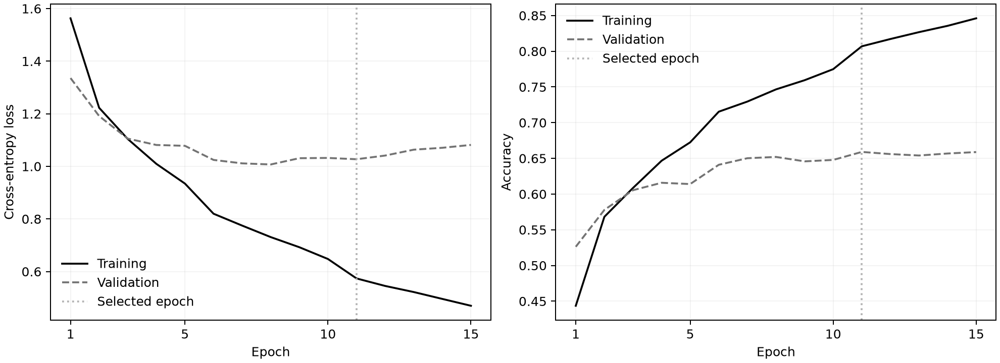
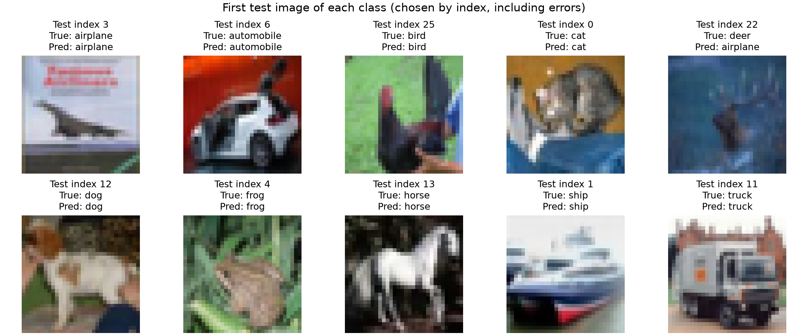

# Assignment 2: CIFAR-10 classifier

Harry Wu | APAN PS5560 | Applied Generative AI

Repository: [ShikiRyo1/apan5560-assignment2](https://github.com/ShikiRyo1/apan5560-assignment2)

I implemented the CNN specified in the assignment and added image classification to my previous FastAPI application. The repository includes the trained checkpoint, so running the API does not require training or downloading a model at startup. The previous `/embedding` and `/generate` routes are still available.

## Run with Docker

From this directory, with Docker Desktop running in Linux-container mode:

```bash
docker build -t assignment2 .
docker run --rm --name assignment2 -p 127.0.0.1:8000:8000 assignment2
```

Open <http://127.0.0.1:8000/docs>. Expand **POST /classify**, select **Try it out**, choose `examples/cat.png`, then select **Execute**. The JSON response contains `class_name`, its softmax score, and scores for all ten classes. The image is resized by the server; the upload does not need to be 64 x 64.

The first Docker build needs internet access for Python packages and the spaCy model retained from Assignment 1. The trained CNN is copied from `models/cifar10_cnn.pt`. The container runs on CPU and requires no GPU, local Python installation, account, or API key. Startup loads the spaCy vectors and CNN once; allow time for the first health response. The default `/docs` page loads its Swagger assets from a CDN, while the API itself performs inference offline.

On Windows PowerShell:

```powershell
curl.exe -X POST "http://127.0.0.1:8000/classify" -F "file=@examples/cat.png"
curl.exe "http://127.0.0.1:8000/model"
curl.exe "http://127.0.0.1:8000/embedding?word=apple"
```

On macOS/Linux use `curl` in place of `curl.exe`. To stop the running container from another terminal:

```bash
docker stop assignment2
```

An alternative is `docker compose up --build`; stop it with `docker compose down`. If port 8000 is occupied, publish `127.0.0.1:8002:8000` and use port 8002 in the browser.

## Model and preprocessing

| Layer | Output per image | Trainable parameters |
|---|---:|---:|
| RGB input | 3 x 64 x 64 | 0 |
| Conv2d, 16 filters, 3 x 3, stride 1, padding 1 | 16 x 64 x 64 | 448 |
| ReLU, MaxPool2d 2 x 2, stride 2 | 16 x 32 x 32 | 0 |
| Conv2d, 32 filters, 3 x 3, stride 1, padding 1 | 32 x 32 x 32 | 4,640 |
| ReLU, MaxPool2d 2 x 2, stride 2 | 32 x 16 x 16 | 0 |
| Flatten | 8,192 | 0 |
| Linear, 100 units, ReLU | 100 | 819,300 |
| Linear, 10 units | 10 logits | 1,010 |
| Total | | **825,398** |

The model follows the worksheet without adding BatchNorm, Dropout, or extra layers. Both convolutions and linear layers include a bias. PyTorch uses NCHW input order, so one image becomes `[1, 3, 64, 64]`.

CIFAR-10 images start at 32 x 32. Training and serving use the same preprocessing functions: correct EXIF orientation when present, convert to RGB, resize to 64 x 64 with Pillow bilinear interpolation, put channels first, and normalize each channel with `(pixel / 255 - 0.5) / 0.5`. The constants are fixed; no test-set statistics are used. Resizing makes the input match the assignment but does not add image detail.

The final layer returns logits. Training passes those logits directly to `CrossEntropyLoss`. At inference, softmax converts them to ten scores and argmax chooses the class. The returned `confidence` is the largest softmax score, not a calibrated probability of being correct.

Class IDs follow the standard CIFAR-10 order:

```text
0 airplane    1 automobile    2 bird    3 cat    4 deer
5 dog         6 frog          7 horse   8 ship   9 truck
```

## Training and evaluation

I split the official 50,000 training images into 45,000 training and 5,000 validation images using seed 42, with 500 validation images per class. I trained for a fixed 15 epochs with Adam (initial learning rate 0.001, weight decay 0.0001), batch size 256, and a StepLR scheduler that halves the learning rate every five epochs. I did not use augmentation or a hyperparameter search. I saved the earliest checkpoint with the highest validation accuracy and evaluated the official 10,000-image test set after that selection.

| Recorded result | Value |
|---|---:|
| Selected epoch | 11 of 15 |
| Best validation accuracy | 65.90% |
| Held-out test accuracy | **65.22% (6,522 / 10,000)** |
| Test cross-entropy loss | 1.041706 |
| Recorded training/evaluation wall time | 63.85 seconds |
| Training hardware | NVIDIA GeForce RTX 3070 |
| Training runtime | PyTorch 2.11.0+cu128; torchvision 0.26.0+cu128 |

The wall time comes from this recorded run and is not a promise for another computer. `results/training.log`, `history.json`, `metrics.json`, `split_indices.npz`, and `test_predictions.csv` contain the execution evidence. The checkpoint SHA-256 is:

```text
9f4e454bfdef8850eebdc293e6811ce6fed77dc645f7f0d49030c690b9289b95
```



Training accuracy keeps increasing while validation accuracy levels off near 66%, which indicates overfitting. I kept the validation-selected checkpoint instead of the last epoch. The reported test result is for the specified small architecture; it does not establish reliable performance on arbitrary photographs or classes outside CIFAR-10.



These examples are the first test image of each true class, chosen by index. The deer example is misclassified as an airplane; it is included rather than replaced with a correct prediction. They illustrate individual outputs and are not an accuracy estimate.

## API contract

| Method and route | Input | Output |
|---|---|---|
| `POST /classify` | Multipart form field `file`: PNG/JPEG | Class ID/name, score, all class scores, original dimensions, model tensor shape |
| `GET /model` | None | CNN class order, preprocessing, selected epoch, checkpoint hash |
| `GET /health` | None | Existing spaCy health contract; startup also loads the CNN |
| `GET /embedding?word=apple` | One alphabetic word | The existing 300-dimensional spaCy vector |
| `POST /generate` | `{"start_word":"the","length":5}` | Text from the existing course bigram generator |

The classification route accepts at most 5 MiB and 20 million decoded pixels. It checks the decoded file format rather than trusting the filename or MIME label. Missing, empty, corrupt, and unsupported images return HTTP 422; uploads beyond the byte or pixel limit return HTTP 413. PNG metadata rejected by Pillow's decoding limits and malformed EXIF/XMP also return 422. Grayscale and RGBA inputs are converted to RGB. Classification always returns one of the ten known classes; it does not detect out-of-distribution inputs.

## Local setup and tests

With Python 3.12 and [uv](https://docs.astral.sh/uv/) installed:

```bash
uv sync --frozen
uv run --frozen pytest -q
uv run --frozen uvicorn app.main:app --host 127.0.0.1 --port 8000
```

The lockfile resolves CPU PyTorch for Windows/Linux. Tests check architecture shapes and parameter count, gradients, preprocessing, validation-based checkpoint selection, split integrity, real checkpoint HTTP predictions, error handling, and the existing word-vector/text-generation behavior. Prediction checks use the actual trained checkpoint.

The final local run passed **50 tests** in 7.00 seconds. The tests include malformed EXIF/XMP and compressed PNG metadata, and verify that an internal model fault is not mislabeled as an invalid upload. `results/pytest_results.xml` stores the results; the run had one upstream Starlette warning about a future test-client transport change, with no failing tests. `results/runtime_and_split_audit.json` records the actual training-library versions and verifies 4,500 training / 500 validation images in each class. The source hashes in `results/source_hashes_implementation.json` use UTF-8 file bytes with LF line endings; normalize CRLF to LF before comparing a Windows checkout.

To retrain on CPU in the locked environment (this replaces the model and result files):

```bash
uv sync --frozen --group train
uv run --frozen --group train python -m scripts.train --data-dir data --download --epochs 15 --batch-size 256
uv run --frozen --group train python -m scripts.plot_results
```

For the recorded GPU run, I used the existing course environment with CUDA PyTorch 2.11.0+cu128 and torchvision 0.26.0+cu128 and ran the same `scripts.train` command against the verified local CIFAR-10 cache. A seed and deterministic algorithms make the procedure explicit, but different hardware/library builds may not produce bit-identical weights. The included checkpoint is the reference for the reported metrics and API examples.

## Files and references

- `app/cnn.py`: the assigned architecture.
- `app/preprocessing.py`: the shared image pipeline.
- `app/classifier.py`: checkpoint loading, image validation, and inference.
- `app/main.py`, `app/schemas.py`: HTTP routes and response schemas.
- `app/embeddings.py`, `app/bigram_model.py`: preserved Assignment 1 functionality.
- `scripts/train.py`: deterministic split, training, checkpoint selection, and final test evaluation.
- `scripts/plot_results.py`: plots generated from recorded results.
- `models/`, `examples/`, `results/`, `tests/`: checkpoint, reproducible uploads, evidence, and tests.

Sources: the course Assignment 2 worksheet and CNN practical; the [CIFAR-10 dataset](https://www.cs.toronto.edu/~kriz/cifar.html); official [Conv2d](https://docs.pytorch.org/docs/2.11/generated/torch.nn.Conv2d.html), [CrossEntropyLoss](https://docs.pytorch.org/docs/2.11/generated/torch.nn.CrossEntropyLoss.html), and [FastAPI file-upload](https://fastapi.tiangolo.com/tutorial/request-files/) documentation. The spaCy model is retained from my [Assignment 1 repository](https://github.com/ShikiRyo1/apan5560-assignment1).
